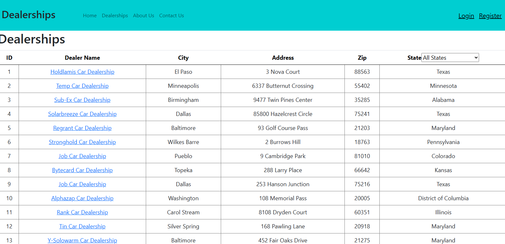
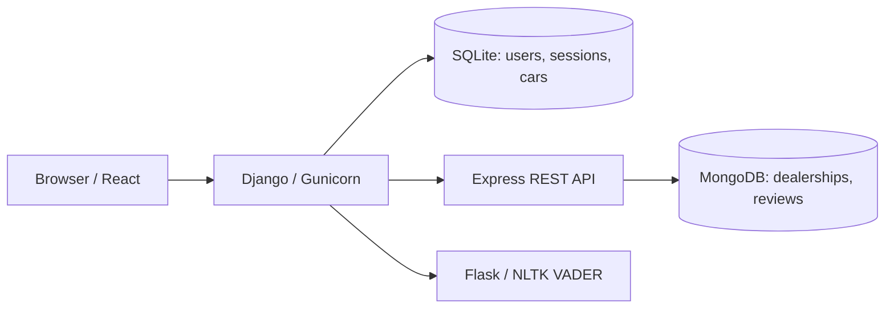
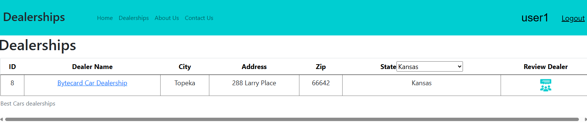
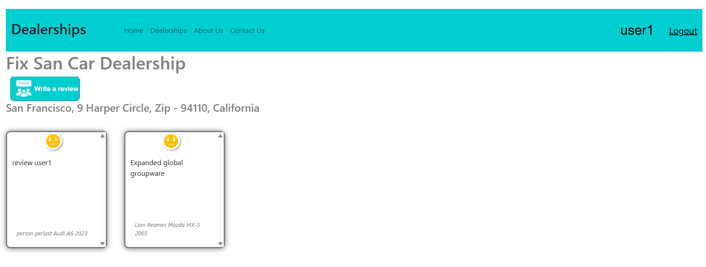

# Best Cars
### A full-stack dealership review platform with sentiment analysis

[](https://github.com/ahmedghaffar5/xrwvm-fullstack_developer_capstone/actions/workflows/main.yml)
[](LICENSE)

Browse dealerships, filter by state, and share a review with its automatically
classified sentiment. Best Cars connects a React interface to Django session
authentication, an Express/MongoDB data service, and a Flask/NLTK sentiment service.

**Developed and extended by [Ahmed Ghaffar](https://github.com/ahmedghaffar5).**
Built on the IBM Skills Network Full Stack Capstone starter; original attribution
and license are retained. This repository is an educational portfolio application,
not a production service. [Origin and attribution](docs/ACKNOWLEDGEMENTS.md).

[Quick start](#quick-start) | [Architecture](docs/ARCHITECTURE.md) |
[API reference](docs/API.md) | [Deployment](docs/DEPLOYMENT.md) |
[Quality and trade-offs](docs/QUALITY.md)



## What the application does

- **Explore dealerships:** browse the sample directory, filter by US state, and
  open individual dealership pages.
- **Manage accounts:** register, log in, and log out using Django's server-side
  sessions rather than trusting a browser-only login flag.
- **Submit reviews:** select a car make, model, and year; record a purchase when
  relevant; and publish a review attributed to the authenticated account.
- **Understand feedback:** display positive, neutral, or negative sentiment using
  NLTK VADER in a separate Flask service. This is a lexicon-based classifier, not
  a custom-trained language model.
- **Administer car data:** manage car makes and models through Django Admin.
- **Run across environments:** use Docker Compose for a local demonstration and
  IBM Container Registry, Code Engine, and Kubernetes for the documented cloud
  workflow.

## Architecture at a glance



| Layer | Technology | Responsibility |
| --- | --- | --- |
| Interface | React, React Router, Bootstrap | Account forms, directory, filters, review views |
| Application | Django, Gunicorn, WhiteNoise | Sessions, admin, JSON APIs, built frontend assets |
| Application data | SQLite | User accounts, sessions, car makes and models |
| Dealership service | Node.js, Express, Mongoose | Dealership lookup and review persistence |
| Review data | MongoDB | Sample dealerships and customer reviews |
| Sentiment | Flask, NLTK VADER | Text classification through an HTTP endpoint |
| Delivery | Docker, Compose, GitHub Actions | Packaging, checks, and image smoke testing |
| Cloud demonstration | IBM Code Engine, Container Registry, Kubernetes | Deployed service integration |

The public directory uses 50 starter dealership records. The car catalogue seeds
five makes and fifteen models. These are sample records, not a production customer
or dealership dataset.

## Quick start

**Prerequisites:** Python 3.12 for application development, Node.js 22 with npm,
Docker Engine/Desktop with Compose v2, and Git. The setup helper also works with
Python 3.10+. A fresh frontend build is required before building the Django image.

```bash
git clone https://github.com/ahmedghaffar5/xrwvm-fullstack_developer_capstone.git
cd xrwvm-fullstack_developer_capstone
python scripts/init_env.py
cd server/frontend
npm ci --include=dev --no-audit --no-fund
npm run build
cd ../..
docker compose --env-file .env -p bestcars-portfolio -f server/docker-compose.local.yml up --build -d
```

Use `python3` instead of `python` where needed. `scripts/init_env.py` creates a
private local `.env` with a generated key; it refuses to overwrite an existing
file. The Compose project name isolates this demonstration from earlier lab
containers and volumes. Ports must be free before starting it.

Open **http://localhost:8000/**. Register a normal account from the interface.
To create an administrator, run the following and choose your own password:

```bash
docker compose --env-file .env -p bestcars-portfolio -f server/docker-compose.local.yml exec django python manage.py createsuperuser
```

Never use a published demonstration password for a publicly accessible service.
For Windows, service-by-service development, troubleshooting, and stopping the
stack without deleting data, see [local setup](docs/LOCAL_SETUP.md).

## A short walkthrough

1. Open **Dealerships**, select **Kansas**, then return to **All States**.
2. Register an account and confirm your username appears in the navigation.
3. Open a dealership, choose **Write a review**, and select a car.
4. Submit a review and view it on the dealership page with its sentiment.
5. Log out and confirm the authenticated review control is no longer available.

<details>
<summary>More screenshots from the deployed demonstration</summary>

**State filtering**



**Dealer details and sentiment-labelled reviews**



</details>

The screenshots are historical captures of the working IBM demonstration. Browser
chrome was cropped for presentation; the application content was not fabricated.
The temporary Skills Network URL is not advertised as a permanent live demo.

## Quality checks

The workflow in [`.github/workflows/main.yml`](.github/workflows/main.yml) runs
Python linting, JavaScript linting, Django tests, a strict React build, and a
containerized static-page smoke check. The badge reflects the repository's actual
workflow status, not a hand-written claim that a build passed.

```bash
cd server
python -m pip install -r requirements.txt
python manage.py check
python manage.py makemigrations --check --dry-run
python manage.py test
```

From the repository root, with the local stack running:

```bash
python scripts/smoke_http.py --base http://localhost:8000 --integration
```

The inherited test suite includes five Django tests; its sentiment proxy test
uses mocks. Unit tests are not a replacement for the live service checks above.
See [quality notes](docs/QUALITY.md) for verification boundaries and remaining work.

## Engineering decisions

**Keep the browser on one origin.** Django serves the built React UI and exposes
proxy APIs, while downstream service URLs remain server-side configuration.

**Build React before the Python image.** This preserves the build path that worked
in the constrained IBM lab and avoids repeating npm installation inside that
image. The Docker build fails early when `frontend/build/index.html` is absent.
CI builds and transfers that artifact before testing the image.

**Collect assets into their actual URL layout.** React's `build/static` directory
is collected to `/static/`, so `/static/js/...` resolves without copying files into
a running pod. The source configuration now represents this fix.

**Make trade-offs explicit.** SQLite is convenient for a single-instance demo;
public production use needs persistence planning, stronger authentication
hardening, and dependency review. [Security notes](SECURITY.md).

## Repository layout

```text
.github/workflows/       CI checks and container smoke test
docs/                    Architecture, setup, API, deployment, screenshots
scripts/                 Local environment setup and HTTP smoke check
server/
  djangoapp/             Authentication, domain models, proxies, tests
    microservices/       Canonical Flask/NLTK sentiment service
  djangoproj/            Django settings and application routes
  database/              Express/Mongoose service and sample JSON data
  frontend/              React source and standalone pages
  Dockerfile             Python image containing a prebuilt React bundle
  docker-compose.local.yml
  deployment.yaml        Configurable Kubernetes example
LICENSE                  Original Apache-2.0 license
```

## Deployment and scope

A working version was demonstrated in IBM Skills Network with Flask on Code
Engine and Django running as a Kubernetes Deployment. The portfolio configuration
is designed for a fresh build; publish a release only after its new CI run and
integration checks pass. Cloud resources, registry access, runtime secrets, and
storage must be supplied for each new environment.

This repository intentionally excludes grading rubrics, submission checklists,
private command transcripts, evidence archives, and AI execution instructions.
It retains the application source, tests, data, license, and technical documentation.

## License and acknowledgement

[Apache License 2.0](LICENSE). Adapted from the
[IBM Skills Network starter](https://github.com/ibm-developer-skills-network/xrwvm-fullstack_developer_capstone).
See [acknowledgements](docs/ACKNOWLEDGEMENTS.md) for the distinction between starter
material and the implementation/integration work represented here.
